# 낚시섬 물고기 도감

섬에 사는 물고기 **34종** 전체 목록이에요. 사진은 게임 안의 사진 기능(`fishThumbnail`)으로 그린 것과 같아요.

- 희귀도: 잡어 · 일반 · 희귀 · 에픽 · 전설
- 싸움 방식: **돌진**(가끔 세게 확 당김) · **지구전**(약하게 자주 당김) · **변덕**(언제 얼마나 당길지 모름) · 전설은 셋을 번갈아
- 판매가는 무게가 무게 범위의 가운데일 때 기본가이고, 무거울수록 비싸요
- 확률: 구역마다 일반 60 · 희귀 24 · 에픽 8 · 잡어 8 비율을 같은 희귀도 어종끼리 나눠 가져요(세게 던지면 희귀·에픽이 늘어요). 동굴은 전설이 주로 나와요
- 해변 에픽은 구조대 가자미와 추멸치떼 둘이 해변 에픽 몫(8)을 반씩 나눠요. 해변 희귀는 13종이 희귀 몫(24)을 나눠요

## ① 선착장 해변

| 사진 | 이름 | 희귀도 | 싸움 방식 | 무게 | 기본가(코인) | 도감 설명 |
|---|---|---|---|---|---|---|
| 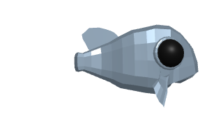 | **졸린 정어리** `sleepy-sardine` | 일반 | 지구전 · 힘 2 | 0.1~0.3kg | 10 | 늘 반쯤 감긴 눈. 잡혀도 크게 저항하지 않는다. |
| 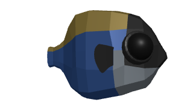 | **수다쟁이 전갱이** `chatty-mackerel` | 일반 | 돌진 · 힘 3 | 0.2~0.6kg | 14 | 입을 쉬지 않는다. 가끔 확 튀어 오른다. |
| 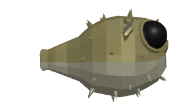 | **뽀글 복어** `bubble-puffer` | 일반 | 변덕 · 힘 3 | 0.3~0.8kg | 16 | 놀라면 부풀었다 줄었다, 종잡을 수 없다. |
| 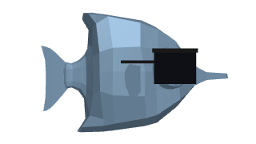 | **선글라스 고등어** `sunglasses-mackerel` | 희귀 | 돌진 · 힘 4 | 0.5~1.5kg | 40 | 바다에서 제일 힙한 녀석. 순간 가속이 엄청나다. |
| 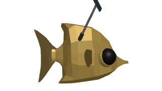 | **셀카 날치** `selfie-flyingfish` | 희귀 | 돌진 · 힘 4 | 0.3~0.9kg | 45 | 물 위로 튀어 오를 때마다 셀카를 찍는다. |
| 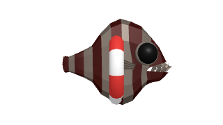 | **구조대 가자미** `lifeguard-flounder` | 에픽 | 지구전 · 힘 6 | 1~4kg | 140 | 빨간 구명튜브를 두르고 해변을 순찰한다. |

## ② 숲속 연못

| 사진 | 이름 | 희귀도 | 싸움 방식 | 무게 | 기본가(코인) | 도감 설명 |
|---|---|---|---|---|---|---|
| 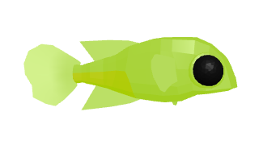 | **반딧불 송사리** `firefly-minnow` | 일반 | 지구전 · 힘 2 | 0.05~0.2kg | 12 | 밤마다 꼬리가 깜빡인다. |
| 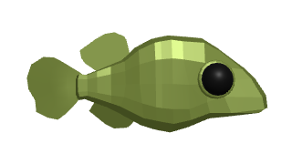 | **개굴 메기** `ribbit-catfish` | 일반 | 변덕 · 힘 3 | 1~3kg | 20 | 개구리 소리를 흉내 낸다. 이유는 아무도 모른다. |
| 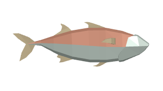 | **무지개 송어** `rainbow-trout` | 희귀 | 돌진 · 힘 5 | 1~2.5kg | 45 | 비늘이 일곱 빛깔로 반짝인다. |
| 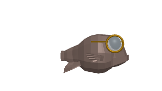 | **안경 박사 붕어** `professor-crucian` | 희귀 | 변덕 · 힘 4 | 0.3~1.2kg | 50 | 동그란 안경을 쓴, 연못에서 제일 똑똑한 붕어. |
| 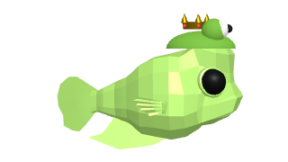 | **개구리 왕자 잉어** `frog-prince-carp` | 희귀 | 지구전 · 힘 5 | 1~3kg | 55 | 개구리 모자 위에 작은 왕관. 뽀뽀하면 뭐가 될까. |
| 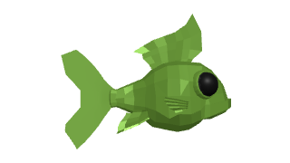 | **이끼 거북잉어** `moss-carp` | 에픽 | 지구전 · 힘 7 | 3~6kg | 120 | 등에 이끼가 자랄 만큼 오래 산 잉어. 지치지 않는다. |
| 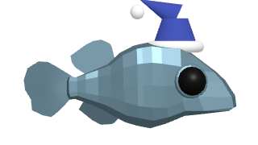 | **잠꾸러기 메기왕** `sleepy-catfish-king` | 에픽 | 돌진 · 힘 7 | 4~10kg | 160 | 수면 모자를 쓰고 졸다가 갑자기 돌진한다. |

## ③ 암초 앞바다

| 사진 | 이름 | 희귀도 | 싸움 방식 | 무게 | 기본가(코인) | 도감 설명 |
|---|---|---|---|---|---|---|
| 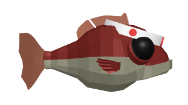 | **근육 도미** `buff-seabream` | 일반 | 지구전 · 힘 4 | 1~3kg | 25 | 매일 파도를 상대로 운동한다. |
| 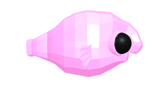 | **디스코 해파리** `disco-jelly` | 희귀 | 변덕 · 힘 5 | 0.5~2kg | 60 | 물속에서 혼자 조명을 켜고 춤춘다. |
| 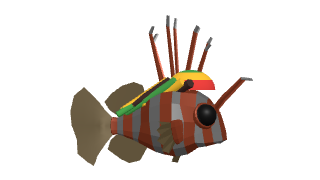 | **레게 쏠배감펭** `reggae-lionfish` | 희귀 | 변덕 · 힘 5 | 0.5~1.5kg | 65 | 지느러미가 레게 머리처럼 휘날린다. |
| 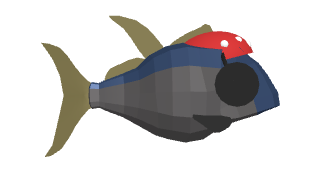 | **해적 참치** `pirate-tuna` | 에픽 | 돌진 · 힘 8 | 10~30kg | 200 | 안대를 찼다. 낚싯줄을 노리고 돌진한다. |
|  | **번개 장어** `thunder-eel` | 에픽 | 변덕 · 힘 8 | 2~5kg | 180 | 몸에서 찌릿찌릿 전기가 흐른다. |
| 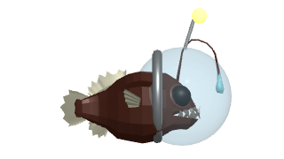 | **우주비행사 아귀** `astronaut-angler` | 에픽 | 지구전 · 힘 8 | 3~8kg | 220 | 헬멧 속 초롱이 별처럼 빛난다. |
| 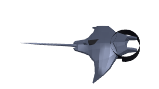 | **닌자 가오리** `ninja-ray` | 에픽 | 변덕 · 힘 8 | 5~15kg | 230 | 검은 복면. 눈 깜짝할 새 사라진다. |

## ④ 동굴 지하호수

| 사진 | 이름 | 희귀도 | 싸움 방식 | 무게 | 기본가(코인) | 도감 설명 |
|---|---|---|---|---|---|---|
|  | **수정 눈 동굴어** `crystal-eye-cavefish` | 에픽 | 변덕 · 힘 8 | 1~3kg | 260 | 눈 대신 빛나는 수정. 동굴에만 산다. |
| 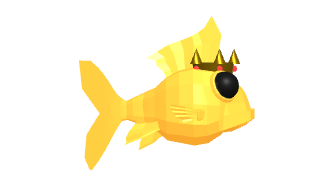 | **왕관 쓴 황금 잉어** `golden-crown-carp` | 전설 | 세 가지를 번갈아 · 힘 10 | 8~12kg | 1000 | 섬의 전설. 세 가지 얼굴로 낚시꾼을 시험한다. |

## 🧑‍🤝‍🧑 스터디원 물고기 (선착장 해변 · 희귀, 추멸치떼만 에픽)

스터디원들을 닮은 물고기들이에요. 이름 말장난 + 외형 + 쓸데없이 진지한 도감 설명이 포인트.

| 사진 | 이름 | 희귀도 | 싸움 방식 | 무게 | 기본가(코인) | 도감 설명 |
|---|---|---|---|---|---|---|
| 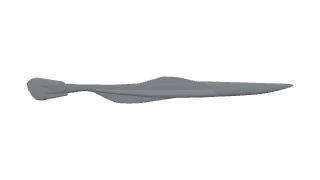 | **개멸치뼈인식** `skinny-anchovy-insik` | 희귀 | 변덕 · 힘 2 | 0.01~0.03kg | 40 | 잡으면 낚싯바늘이 더 무겁다. 구워 먹으려 했는데 이쑤시개가 됐다. _체중 ★☆☆☆☆ / 자존심 ★★★★★_ |
| 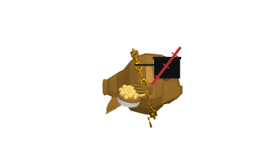 | **누룽지이은지** `nurungji-eunji` | 희귀 | 돌진 · 힘 6 | 1~3kg | 60 | 노릇노릇 동글동글 형님. 빵 먹을 때 건드리면 손가락을 잘라 간다. _서열 ★★★★★ / 빵 ★★★★★_ |
| 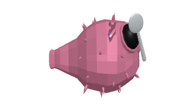 | **또먹냐김우걱** `ugeok-kimugeok` | 희귀 | 지구전 · 힘 7 | 8~15kg | 70 | 먹이를 주면 잡기 쉬워진다. 단, 먹이가 먼저 사라진다. _포만감 측정불가_ |
| 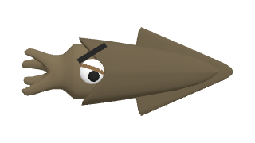 | **마른오징어정훈** `squid-ojeonghun` | 희귀 | 변덕 · 힘 4 | 0.5~1.5kg | 50 | 본인은 물고기라고 주장한다. 아무도 물어본 적 없다. _물고기력 ★☆☆☆☆ / 억울함 ★★★★★_ |
| 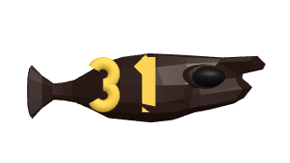 | **XXL배정빈** `eelgas-baejeongbin` | 희귀 | 돌진 · 힘 7 | 10~25kg | 80 | 한 마리가 출현하면 수조 정원이 초과된다. 사이즈 선택은 불가능하다. _1인분 기준 8인분_ |
|  | **눈밖에김가은** `bigeye-kimgaeun` | 희귀 | 지구전 · 힘 3 | 0.5~1.5kg | 50 | 시야각 340°. 코는 업데이트 예정. _시야 ★★★★★ / 코 ★☆☆☆☆_ |
| 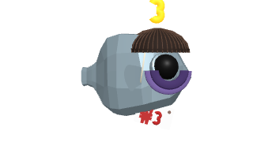 | **연차3원준** `three-wonjun` | 희귀 | 변덕 · 힘 3 | 0.29~0.31kg | 3 | 연차가 3개 남았다. 체력은 0개 남았다. _남은 연차 3 / 헤어스타일 이해 불가_ |
| 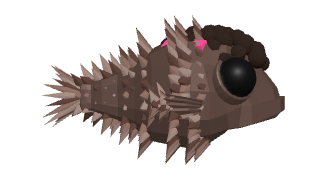 | **털밖에윤종헌** `hairy-ajumma-jongheon` | 희귀 | 지구전 · 힘 5 | 1~3kg | 55 | 털갈이 철에는 개체 수가 두 배로 보인다. 절반은 털이다. _털 ★★★★★ / 지느러미 확인 불가_ |
| 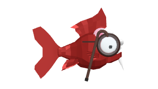 | **할아범이적범** `grandpa-escapee` | 희귀 | 돌진 · 힘 5 | 1~2.5kg | 60 | 싸사모(싸우나를 사랑하는 모임) 회장님. 오후 8시 이후 발견 기록이 없다. _사우나 ★★★★★ / 주량 ★☆☆☆☆ / 활동시간 05:30~20:00_ |
| 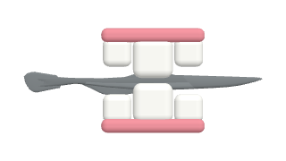 | **배정빈 이 사이에 낀 추멸치** `stuck-anchovy-chu` | 희귀 | 변덕 · 힘 2 | 0.01~0.02kg | 30 | XXL배정빈의 점심 메뉴였다. 이쑤시개로도 안 빠진다. _탈출 시도 ★★★★★ / 성공률 ☆☆☆☆☆_ |
| 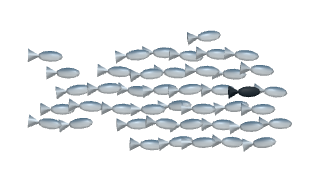 | **추멸치떼** `anchovy-school-chu` | 에픽 | 변덕 · 힘 6 | 0.3~0.8kg | 120 | 추멸치가 힘을 합쳤다. 합쳐도 멸치다. _개체 수 ★★★★★ / 개체당 체중 ★☆☆☆☆_ |

## 잡어

| 사진 | 이름 | 희귀도 | 싸움 방식 | 무게 | 기본가(코인) | 도감 설명 |
|---|---|---|---|---|---|---|
| 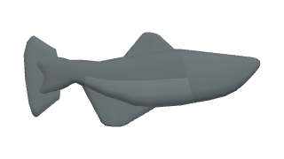 | **길 잃은 멸치** `lost-anchovy` | 잡어 (선착장 해변, 숲속 연못, 암초 앞바다) | 지구전 · 힘 1 | 0.01~0.05kg | 1 | 무리에서 떨어진 작은 멸치. 어항 먹이로 쓸 수 있다. |

---

## 물고기 추가하는 법

1. `src/game/data/fish.ts`의 `FISH_SPECIES`에 한 줄: id, 이름, 설명, 사는 구역, 희귀도, 싸움 방식, 힘(1~10), 무게 범위, 기본가, 대표 색, (선택) `trivia` 스탯 한 줄
2. `src/game/data/fishLooks.ts`의 `FISH_LOOKS`에 한 줄: 모델, 색(`tint`), 빛(`glow`), 크기(`size`), 몸 비율(`stretch`), 회전(`rotate`), 휘청거림(`wobble`), 소품(`accessories`)
3. `npx vitest run` — 생김새가 빠졌거나 다른 물고기와 똑같이 생기면 테스트가 알려 줘요
4. 이 문서의 사진은 게임을 켠 상태에서 사진을 다시 뽑아 갱신해요
