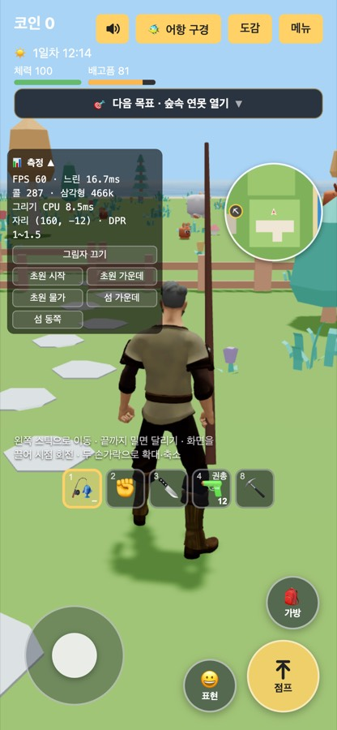
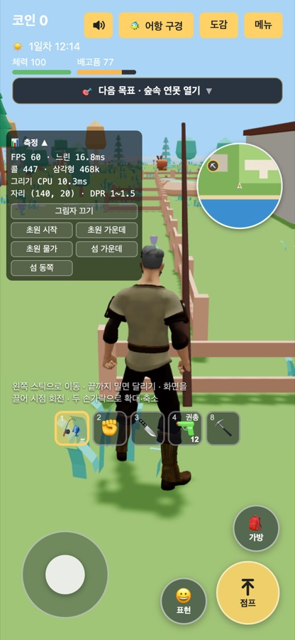
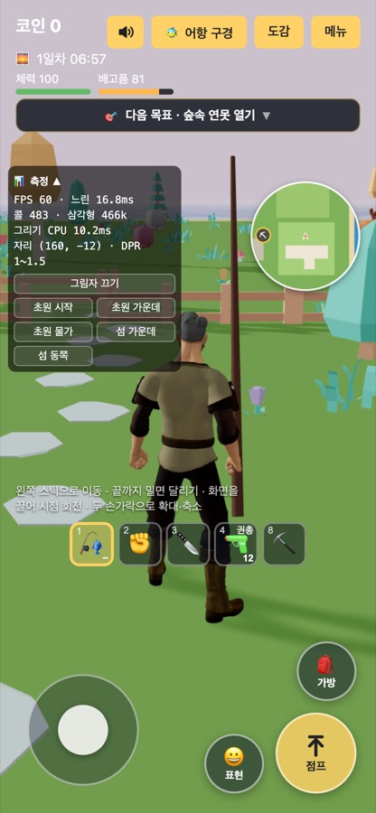
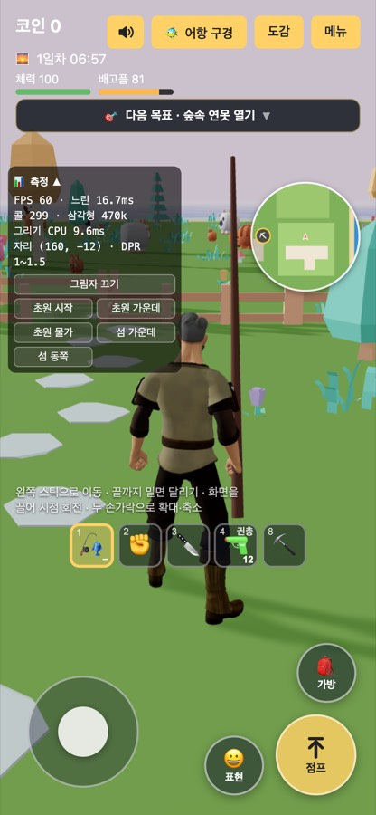
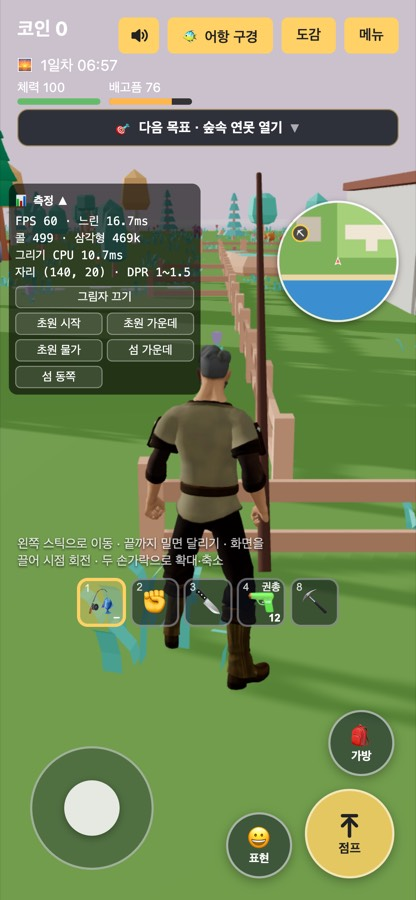

# 그림자 정리·동물 합치기 측정 보고서 (2026-11-28)

브랜치 `perf/measure`. 고치기 전(`1c9642d`, 측정 도구만 들어간 상태)과 후(그림자 정리 + 동물 합치기 + 코덱스 리뷰 반영)를
같은 조건에서 잰 결과.

## 무엇을 바꿨나

1. **그림자 범위를 보는 쪽 앞으로** (`src/game/logic/shadowFocus.ts`, `src/meadow/MeadowLighting.tsx`)
   - 해 그림자는 플레이어 둘레 ±22m 를 사방으로 똑같이 덮었다. 이제 카메라가 보는 쪽 4m 앞을 가운데로 ±20m 를 덮는다
   - 뒤를 10m 만 남겼을 때(앞 8m·±18m)는 화면 앞쪽 울타리 그림자가 사라져 늘렸다
   - 아래·위로 기울일수록 앞으로 덜 옮긴다 (바로 아래를 봐도 가운데가 덜컥 튀지 않게)
2. **밖으로 난 문이 없는 방 안 물체는 그림자를 안 만든다** (`src/game/logic/indoorShadow.ts`, `meadowSingleton.ts`)
   - 집 안은 지붕·바깥벽 그림자로 이미 그늘이라 가구 그림자가 원래 안 보였다
   - 현관이 있는 거실은 열린 문으로 해가 들어올 수 있어 그대로 둔다 (침실·주방·사격장만). 벽·문·지붕도 그대로
3. **동물 부위를 한 번에 그리기** (`src/game/scene/animals/rigidToSkinned.ts`)
   - 동물(Kenney Cube Pets)은 몸통·다리 4개·머리가 메시 하나씩이라 한 마리가 그리기 5~6번 + 그림자 5~6번을 썼다
   - 부위가 모두 같은 재질이라 종마다 한 번 뼈대 메시 하나로 합친다. 부위는 같은 이름의 뼈가 되어 동작 클립이 그대로 붙는다
   - 화면 밖 판정용 구는 처음 자세의 두 배로 넉넉히 잡는다 (three 는 한 번만 재므로, 다리가 움직여 가장자리에서 사라지지 않게)

## 어떻게 쟀나

- 도구: `SUN_T=<시각> REPEAT=3 node tools/render-measure.mjs <게임 주소> <결과.json> mobile`
  - 전: `1c9642d` 를 따로 꺼내(worktree) 5191 포트, 후: 현재 브랜치 5190 포트로 같은 도구로 잼
- 폰 화면 흉내: 390×844, DPR 3, 터치 (게임이 폰 화질을 고른다). 그리기 CPU 는 CPU 4배 느리게
- **시각 고정**: 자리마다 잴 때 게임 시각을 고정한다 (정오 `SUN_T=0.25`, 해가 낮은 아침 06:45 `SUN_T=0.03`). 해가 낮으면 그림자가 길어 뒤쪽 물체 그림자가 화면에 들어오기 쉬워 따로 잰다
- **3번 반복**: 2초 간격으로 3번 잰 범위를 남긴다 (동물이 돌아다녀 흔들린다)
- 그래픽: 이 맥 (Apple M2 Pro). 숫자는 전후 비교용이다
- 원본 결과: [before-0.25.json](before-0.25.json), [after-0.25.json](after-0.25.json), [before-0.03.json](before-0.03.json), [after-0.03.json](after-0.03.json)

## 결과: 드로우 콜 (3번 잰 범위)

### 정오 (12:00)

| 자리 (세계 x, z) | 전 | 후 | 줄어든 비율 |
|---|---|---|---|
| 초원 시작 (160, -12) | 423~432 | **301** | -29% |
| 초원 가운데 (140, 20) | 432~435 | **319~322** | -26% |
| 초원 물가 (95.5, -3) | 243 | 232 | -5% |
| 섬 가운데 (0, 12) | 300~304 | 295~299 | -2% |
| 섬 동쪽 (24, 0) | 237 | 230 | -3% |

### 해가 낮은 아침 (06:45)

| 자리 | 전 | 후 | 줄어든 비율 |
|---|---|---|---|
| 초원 시작 | 492~497 | **301** | -39% |
| 초원 가운데 | 480~494 | **357~359** | -26% |
| 초원 물가 | 291 | 291 | 0% |
| 섬 가운데 | 299~303 | 294~298 | -2% |
| 섬 동쪽 | 235 | 220 | -6% |

- 초원은 25~39% 줄었다. 섬은 거의 그대로다 (섬 그림자는 작은 물체 여러 개에 고루 나뉘어 있어 뺄 큰 덩어리가 없다)
- 반복 범위가 줄어든 양보다 훨씬 작아서 (최대 14콜), 초원의 차이는 흔들림이 아니다. 섬·물가의 몇 콜 차이는 흔들림과 구별하기 어렵다
- 바뀐 3가지 각각의 몫은 따로 재지 않았다. 앞선 측정(시각 고정 전)으로는 초원 시작 자리에서 그림자 정리로 약 170콜, 동물 합치기로 약 50콜이었다
- 그리기 CPU(4배 느리게)는 측정마다 1ms 안팎 흔들려 결론에 쓰지 않는다

## 화면 비교

같은 자리, 같은 시각, 같은 카메라 방향. 그림자 차이는 찾지 못했다 (동물 위치는 다르다).

| | 전 | 후 |
|---|---|---|
| 초원 시작 · 정오 |  |  |
| 초원 가운데 · 정오 |  |  |
| 초원 시작 · 아침 해 낮음 |  |  |
| 초원 가운데 · 아침 해 낮음 |  |  |

## 폰 실측 (고치기 전, iPhone, `?probe` 측정 창)

| 자리 | 그림자 | 콜 | 삼각형 | FPS | 느린 프레임 |
|---|---|---|---|---|---|
| 초원 시작 | 켬 | 502 | 468k | 60 | 17ms |
| 초원 시작 | 끔 | 163 | 337k | 60 | 17ms |
| 초원 가운데 | 켬 | 506 | 471k | 60 | 17ms |
| 초원 가운데 | 끔 | 215 | 339k | 60 | 17ms |

- 이 폰은 고치기 전에도 끊김 없이 60FPS 였다 (DPR 1, 낮은 화질). 줄인 만큼은 낮은 폰·발열·화질(DPR) 올리기에 쓸 여유
- 그림자 끄기 직후 그리기 CPU 는 셰이더를 다시 준비하느라 잠깐 커져 비교에서 뺐다
- 고친 뒤 폰 실측은 아직 없다

## 코덱스 중간 리뷰 반영

| 지적 | 처리 |
|---|---|
| 동물 뼈대 메시의 화면 밖 판정 구가 한 번만 재져, 다리가 움직이면 가장자리에서 사라질 수 있음 | 판정 구를 처음 자세의 두 배로 잡고, 부위를 90° 돌려도 덮는지·복제에 따라가는지 테스트 |
| 현관으로 해가 들어오면 실내 가구 그림자가 빠질 수 있음 | 밖으로 난 문이 있는 방(거실)은 규칙에서 뺌. 문 자리로 판단하는 테스트 |
| 위아래로 볼 때 그림자 범위 가운데가 4m 튈 수 있음 | 기울기만큼 덜 옮기게 바꿈 |
| 시각·동물 때문에 전후 숫자가 흔들림 | 측정 도구에 시각 고정·반복 측정 추가, 해 낮은 시각도 비교 |

남은 것: 1인칭 조준·텔레포트 직후 화면은 따로 비교하지 않았다. 고친 뒤 폰 실측.

## 다음

- 초원 장식 묶어 그리기
- 작은 장식(꽃·풀·버섯) 그림자 빼기는 화면이 조금 바뀌므로 캡처 비교 후 결정
