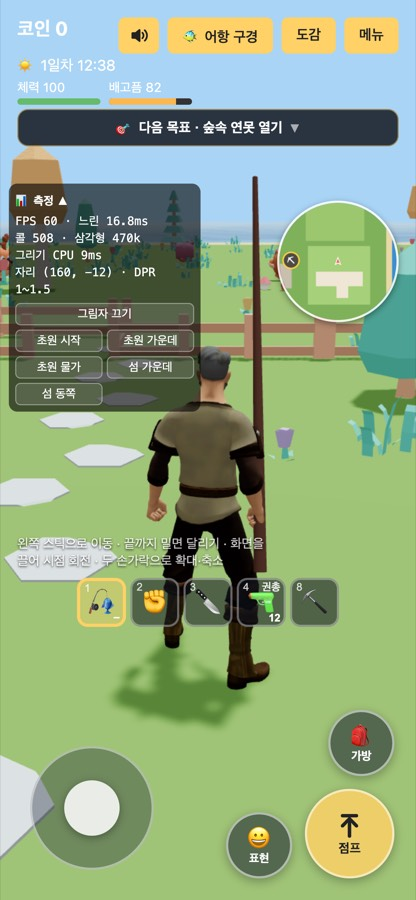
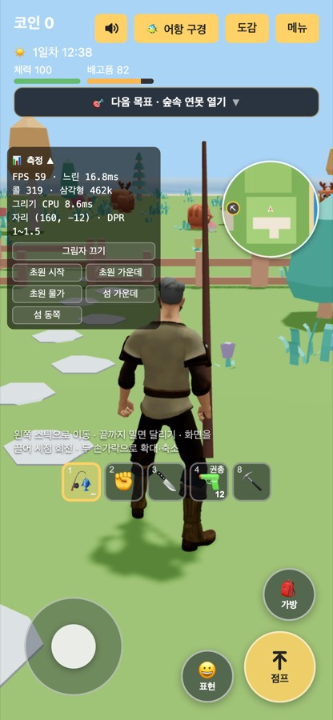
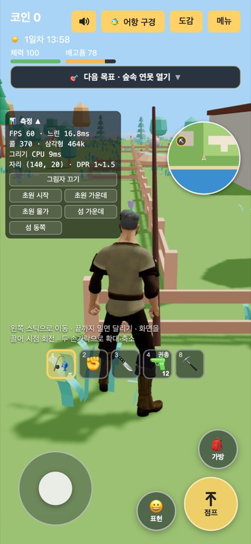

# 그림자 정리 측정 보고서 (2026-11-28)

커밋 `5a7e1c1` "안 보이는 그림자 그리기 줄이기" 전후를 같은 자리에서 잰 결과.

## 무엇을 바꿨나

1. **그림자 범위를 보는 쪽 앞으로**: 해 그림자는 플레이어 둘레 ±22m 를 사방으로 똑같이 덮었다.
   이제 카메라가 보는 쪽 4m 앞을 가운데로 ±20m (앞 24m, 뒤 16m) 를 덮는다.
   뒤를 10m 만 남겼을 때(앞 8m·±18m)는 화면 앞쪽 울타리 그림자가 사라져서 16m 로 늘렸다.
2. **집 안 물체는 그림자를 안 만든다**: 초원 집 방 안에 다 들어 있는 물체(가구 등).
   집 안은 지붕·바깥벽 그림자로 이미 전부 그늘이라 원래 안 보였다. 벽·문·지붕은 그대로 둔다.

## 어떻게 쟀나

- 도구: `node tools/render-measure.mjs http://127.0.0.1:5190 <결과.json> mobile` (개발 서버 `npx vite --host 127.0.0.1 --port 5190 --strictPort`)
- 폰 화면 흉내: 390×844, DPR 3, 터치 (게임이 폰 화질을 고른다), 그리기 CPU 는 CPU 4배 느리게
- 그래픽: 이 맥 (Apple M2 Pro). 숫자는 전후 비교용이다
- 동물이 움직이고 시각이 흘러서 같은 코드도 콜 수가 몇십 정도 흔들린다
- 원본 결과: [before.json](before.json), [after.json](after.json)

## 결과: 드로우 콜

| 자리 (세계 x, z) | 전 | 후 | 줄어든 비율 | 그림자 몫 (추정) 전 → 후 |
|---|---|---|---|---|
| 초원 시작 (160, -12) | 496 | **325** | -34% | 373 → 175 |
| 초원 가운데 (140, 20) | 491 | **366** | -25% | 296 → 172 |
| 초원 물가 (95.5, -3) | 250 | 239 | -4% | 145 → 136 |
| 섬 가운데 (0, 12) | 303 | 298 | -2% | 187 → 183 |
| 섬 동쪽 (24, 0) | 284 | 278 | -2% | 190 → 184 |

- 그림자를 아예 끈 콜 수(본 그리기만)는 전후가 같다: 144 / 191~202 / 99 / 114 / 94. 바뀐 건 그림자 몫뿐이다
- 그리기 CPU(4배 느리게)는 초원 시작 9.1 → 8.3ms, 초원 가운데 9.6 → 9.0ms. 이 값은 측정마다 1ms 안팎 흔들려 참고만 한다
- 섬은 거의 안 줄었다. 섬 그림자는 작은 물체 여러 개에 고루 나뉘어 있어 뺄 큰 덩어리가 없다

## 화면 비교

같은 자리, 같은 카메라 방향. 그림자 차이는 찾지 못했다 (동물 위치·시각은 다르다).

| | 전 | 후 |
|---|---|---|
| 초원 시작 |  |  |
| 초원 가운데 |  |  |

## 폰 실측 (고치기 전, iPhone, `?probe` 측정 창)

| 자리 | 그림자 | 콜 | 삼각형 | FPS | 느린 프레임 |
|---|---|---|---|---|---|
| 초원 시작 | 켬 | 502 | 468k | 60 | 17ms |
| 초원 시작 | 끔 | 163 | 337k | 60 | 17ms |
| 초원 가운데 | 켬 | 506 | 471k | 60 | 17ms |
| 초원 가운데 | 끔 | 215 | 339k | 60 | 17ms |

- 이 폰은 고치기 전에도 끊김 없이 60FPS 였다 (DPR 1, 낮은 화질). 줄인 만큼은 낮은 폰·발열·화질(DPR) 올리기에 쓸 여유
- 그림자 끄기 직후 그리기 CPU 는 셰이더를 다시 준비하느라 잠깐 커져 비교에서 뺐다

## 다음

- 동물: 한 마리가 몸통·다리 4개로 따로 그려져 (그림자 포함) 10콜 넘게 쓴다. 부위를 합친다
- 초원 장식 묶어 그리기
- 작은 장식(꽃·풀·버섯) 그림자 빼기는 화면이 조금 바뀌므로 캡처 비교 후 결정
