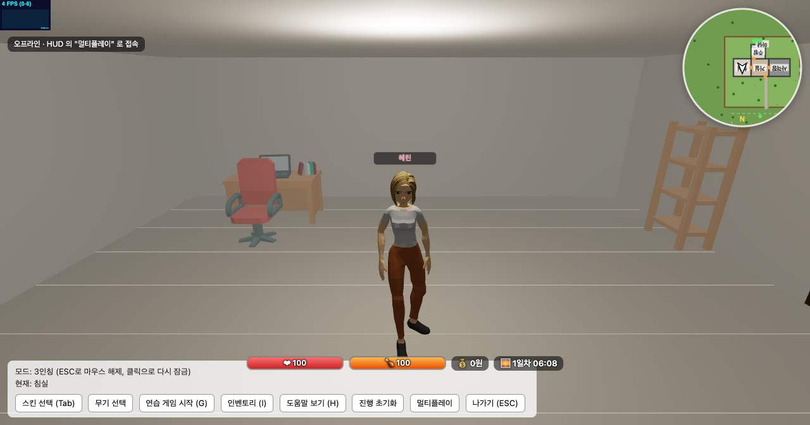
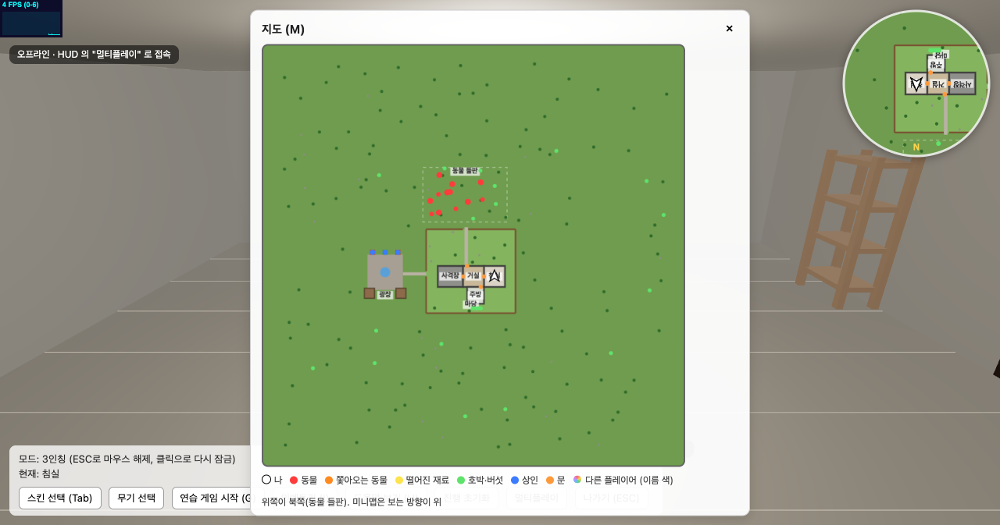
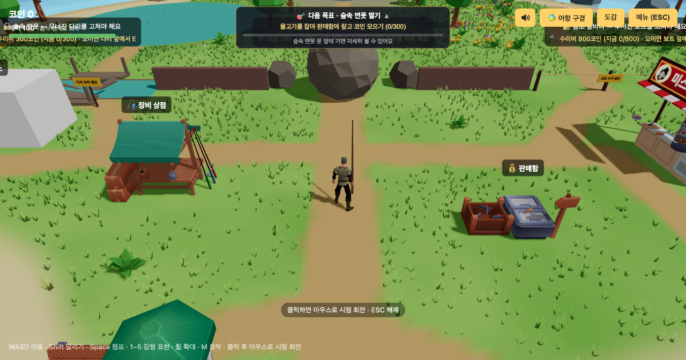
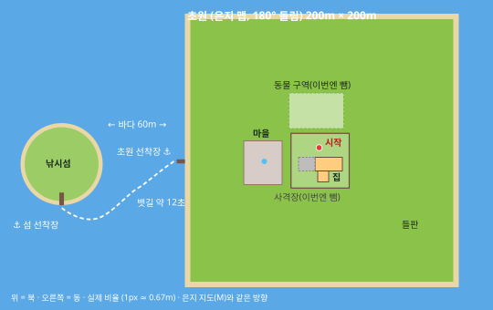

# 초원 + 배로 건너기 설계 (은지 게임 합치기 1·2단계)

> 은지 게임(Room Sim, https://github.com/Eunji1217/3js)의 맵을 낚시섬 R3F 앱 안에 띄우고, 배를 타고 로딩 없이 바다를 건너 낚시섬에 간다.
> 합치기 전체 결정: 기반 기술 (가) R3F, 캐릭터는 혜린 것 (2026-11-17). 이 문서는 그중 1단계(초원 띄우기) + 2단계(배)만 다룬다.

## 목표와 성공 기준

- 게임에 들어오면 하나의 3D 세계 안에 **초원(은지 맵)** 과 **낚시섬** 이 바다를 사이에 두고 있다.
- 초원에서 혜린 캐릭터로 걸어 다닌다: 집 안·마당·들판·마을. 벽·울타리·가구·건물에 막힌다.
- 초원 마을 쪽(서쪽) 선착장에서 배를 타면 약 12초 동안 바다를 건너 낚시섬 선착장에 내린다. 반대 방향도 된다. 로딩 화면이 없다.
- 우측 상단 미니맵에 초원·바다·낚시섬·내 위치가 보인다.
- 같이 하기에서 초원에 있는 사람, 배를 탄 사람도 다른 사람 눈에 보인다.
- 낚시섬의 기존 기능(낚시·상점·수족관·구역 열기·같이 하기)은 그대로 동작한다.

## 작업 방식

- 브랜치 `feat/meadow-boat` 에서 1·2단계를 모두 끝낸 뒤 main 에 한 번에 합친다. 그 전까지 main(= 배포) 은 지금 낚시섬 그대로.
- 확인은 Vercel 미리보기 주소로 한다.
- 서버 변경(좌표 한도, 배 표시)이 있으므로 **서버를 먼저 배포하고 main 을 합친다**. 새 서버는 옛 클라이언트와도 호환된다(아래 "같이 하기").

## 지금 두 게임의 모습

| 은지 게임 (Room Sim) 시작 화면 | 은지 게임 큰 지도 (M) |
|---|---|
|  |  |

은지 지도는 위가 북쪽(동물 들판)이고 **마을(광장)이 집의 왼쪽(서쪽)** 에 있다.

## 1. 지도 배치

- 낚시섬은 지금 자리 그대로: 원점, 반지름 `ISLAND_RADIUS` 30. 낚시 코드가 이를 전제로 하므로 옮기지 않는다.
- 초원 = 은지 맵 전체를 **180° 돌리고** 동쪽으로 200m 옮겨 놓는다. 돌리는 이유: 은지 코드 좌표는 지도에서 오른쪽이 -x 라서, 그대로 놓으면 우리 세계에서 은지 지도와 좌우·위아래가 뒤집혀 보인다. 180° 돌리면 은지 게임을 하던 사람이 보던 방향(위 = 동물 들판, 왼쪽 = 마을) 그대로다.
  - 변환: 세계 `(x, z) = (200 - x_은지, -z_은지)`. 코드에서는 `<group position={[200, 0, 0]} rotation-y={Math.PI}>`.
  - 은지 `GROUND` x -90..110, z -90..110 → 세계 x 90..290, z -110..90.
  - 마을(은지 x 39..67, z -15..17) → 세계 x 133..161, z -17..15. 초원 서쪽 해안 x 90. 해안에서 섬 가장자리(x 30)까지 바다 60m.
- 높이: 두 땅 모두 바닥 y=0 (은지 실내 바닥 0, 바깥 땅 -0.01, 섬 윗면 0). 바다 `WATER_Y` -0.3.
- 방향 이름: 이 문서와 코드에서는 우리 쪽 규칙을 쓴다(위 = 북 = -z, 오른쪽 = 동 = +x). 은지 코드의 좌표값은 손대지 않고 위 변환만 적용한다.

### 바다와 해안

- 바다 판(`Ocean`)을 두 땅을 다 덮게 키운다: 가로 x -90..360, 세로 z -180..160 정도(가운데를 두 땅 사이로 옮긴다). 격자 밀도는 지금과 비슷하게 유지하되 정점 수가 2배를 넘지 않게 한다.
- 지금 바다 셰이더의 "얕은 물·거품"은 섬(원점에서의 거리)만 본다. **해안까지의 거리** 를 섬 원과 초원 사각형 중 가까운 쪽으로 바꾼다(GLSL 에서 둘의 최솟값).
- 초원 가장자리: 은지 맵은 초록 땅이 그냥 끊긴다. 둘레에 폭 4m 모래 띠와, 섬처럼 물 아래로 내려가는 옆면(두께 2m 상자)을 붙인다. 모래 띠는 초원 사각형 안쪽 4m 에 그린다(땅을 넓히지 않는다).

## 2. 은지 코드 가져오기

### 복사할 것

- 코드: `src/meadow/vendor/` 에 은지 저장소의 `world.js, outdoor.js, town.js, furniture.js, door.js, daynight.js, paths.js, items.js` 와 이들이 import 하는 것 중 아래 "뺄 것"에 해당하지 않는 파일. 복사한 커밋을 `src/meadow/vendor/README.md` 에 적는다(현재 `f3c3808`).
- 모델: `public/meadow/models/` 에 `kenney`(가구), `nature`(나무·울타리·풀), `town`(건물·소품), `food`(노점 음식) + 각 `Textures/` 와 `LICENSE.txt`. 약 2.1MB. 모두 CC0.
- `paths.js` 의 `asset()` 이 `BASE_URL + 'meadow/' + path` 를 돌려주게 한 줄 고친다.

### 은지 코드에서 고치는 것 (최소)

아래 넷은 이번에 쓰지 않는다. 복사하지 않은 파일은 동적 import 로도 부를 수 없으므로(빌드가 파일을 찾는다) **복사본에서 그 부분을 지운다**. 은지 원본은 그대로다.

| 빼는 것 | 이유 | 복사본에서 |
|---|---|---|
| 사격장 설비 | 무기·소리 코드를 끌고 온다 | `range.js` import 를 지우고 `RANGE_ROOM` 상수만 world.js 에 옮긴다(빈 방은 남는다) |
| 동물 | 동물 AI 는 3단계 | `animals.js` import 를 지우고 빈 객체로 둔다 |
| 마을 상인 | 상인 모델이 21MB (건물·노점은 남긴다) | town.js 의 `umchar.js` import 와 상인 만들기를 지운다 |
| 거울 | 매 프레임 한 번 더 그린다 | `Reflector` 를 지운다(테두리만 남는다) |

- `range.js`, `animals.js`, `umchar.js`, `weapons.js`, `audio.js` 는 복사하지 않는다.
- 고친 줄마다 `// rinfish:` 주석을 단다(나중에 은지 원본과 비교하기 쉽게).
- 타입: 우리 코드가 import 하는 파일마다 `.d.ts` 를 두고 쓰는 부분만 선언한다(`world.d.ts`: `group, allColliders(), doors, furnitureReady, outdoor.ready, town.ready, lights, ROOMS` / `outdoor.d.ts`, `town.d.ts`: 지도용 상수 / `daynight.d.ts`).
- oxlint·tsc 검사에서 `src/meadow/vendor/` 는 뺀다(남의 코드. 경고 기준선 6 을 늘리지 않는다).

### R3F 에 올리기: `src/meadow/MeadowWorld.tsx`

- `createWorld()` 는 한 번만 부른다(`src/meadow/meadowWorld.ts` 의 싱글턴). 문은 만들자마자 모두 연다(`setOpen(true, true)`). 여닫기는 3단계라 `door.update` 는 부르지 않는다.
- `<group position={[200, 0, 0]} rotation-y={Math.PI}><primitive object={world.group} /></group>` (변환 값은 `data/meadow.ts` 의 `MEADOW_POS`, `MEADOW_YAW`).
- **모델이 다 들어온 뒤에 장면에 붙인다.** 은지 코드는 모델이 도착할 때 `Box3.setFromObject` 로 충돌 상자를 재는데, 이 값은 부모까지 포함한 세계 좌표다. `world.group` 이 이미 돌리고 옮긴 그룹 아래 있으면 늦게 온 상자만 세계 좌표가 되어 섞인다. 그래서 `furnitureReady`, `outdoor.ready`, `town.ready` 가 모두 끝나면(실패한 모델은 빼고, `Promise.allSettled`) 그때 한 번 장면에 붙이고 충돌체를 만든다. 그동안 바닥 충돌체·모래 띠·선착장은 먼저 있어서 초원에서 시작해도 떨어지지 않는다(로딩 화면이 모델 로딩을 기다린다).
- 조명은 **은지 것으로 통일** 한다(아래 "빛"). 은지 해(directional)·하늘빛(hemisphere)·방 조명·마을 가로등을 그대로 쓰고, 우리 `World.tsx` 의 해·환경광은 뺀다.
- 은지 재질은 ACES 톤매핑·sRGB 를 전제로 한다. 우리 Canvas 설정과 다르면 맞춘다(구현 첫 단계에서 확인하고 스크린샷으로 비교).

### 충돌: 상자 → Rapier

- 은지 맵의 충돌은 `Box3[]`(축 정렬 상자). 이를 Rapier 고정(fixed) `CuboidCollider` 로 바꾼다.
- 순수 함수 `src/game/logic/meadowColliders.ts`:
  `boxesToCuboids(boxes: {min:Vec3,max:Vec3}[]): {center: Vec3, half: Vec3}[]`
  - 은지 좌표 상자를 세계 좌표로 바꿔(가운데 `(200 - cx, cy, -cz)`, 반폭은 그대로 — 180° 회전은 축 정렬을 유지한다) 가운데·반폭으로 돌려준다.
  - 두께가 0.01m 보다 얇거나 크기가 비정상(NaN, 무한)인 상자는 버린다.
  - 은지 플레이어는 0.35m 이하 턱은 올라선다. 우리 캐릭터 컨트롤러의 계단 높이와 다르면 낮은 상자(높이 ≤ 0.35)는 그대로 두고 올라서는지 확인만 한다.
- 초원 바닥: 200×200 상자 하나(윗면 y=0).
- 가구·마을은 비동기로 늦게 들어온다. 위처럼 셋이 다 끝난 뒤 `allColliders()` 를 한 번 읽어 충돌체를 만든다.

## 3. 같이 정리할 것

### 땅 경계 (`src/game/logic/land.ts`, 순수 함수)

- 지금: `Player.tsx` 의 `PLAYER_LIMIT = ISLAND_RADIUS - 1` 원 안으로만 다닌다.
- 바꿈: `landAt(x, z): 'island' | 'meadow' | null` 과 `clampToLand(prev, next)`.
  - 섬: 원점 반지름 29 원.
  - 초원: 세계 x 91..289, z -109..89 (1m 안쪽).
  - 선착장 판자 위(아래 "배")도 땅으로 친다.
  - 다음 위치가 땅 밖이면 이전 위치가 있던 땅의 경계로 붙인다(지금 원 경계와 같은 방식).
- 낚시 물가 판정(`fishingEdge`)은 섬 위에서만 한다. 초원에 있을 때 "섬에서 멀다 = 바다"로 잘못 판정하지 않게 `landAt(...) === 'island'` 일 때만 찾는다. 초원 해안 낚시는 3단계.

### 저장 위치와 시작 위치 (`place.ts`)

- `normalizePlace`: 저장된 자리가 섬 또는 초원 위면 인정한다. 둘 다 아니면 시작 자리.
  - 울타리 북쪽(잠긴 구역) 규칙은 섬 위일 때만 적용한다.
- 처음 시작 자리 `START_PLACE` 를 초원 은지 집 마당(집 북쪽)으로 바꾼다: 은지 좌표 (12, 12) → 세계 (188, -12).
- 기존 플레이어는 저장된 섬 자리에서 이어서 시작한다(저장본은 그대로 유효).

### 빛 (은지 조명으로 통일)

한 세계에 해가 둘이면 너무 밝아지고 그림자도 두 겹·두 번 계산이 된다. 그래서 조명은 한 벌만 쓴다. 메인 게임이 은지 맵이고, 은지 낮과 밤(`daynight.js`)이 바로 이 해·하늘빛을 움직이므로 **은지 조명** 을 쓴다.

- 은지 `world.lights` 의 해·하늘빛·방 조명·가로등을 쓴다. 우리 해·환경광(`World.tsx`)은 뺀다.
  - 해·해 목표점·하늘빛은 `world.group` 에서 꺼내 `MeadowLighting` 의 같은 변환 그룹에 바로 붙인다(모델 로딩을 기다리지 않고 처음부터 빛이 있게). 방 조명·가로등은 `world.group` 에 남는다.
- 은지 `DayNight` 를 가져오되 이번엔 **낮(정오)으로 고정** 한다. 그래도 `daynight.update(dt, 플레이어 위치)` 는 매 프레임 불러, 해와 그림자 범위가 플레이어를 따라다니게 한다(초원과 섬 어디서나 그림자).
  - 은지 해의 그림자 범위(±22m)와 그림자 지도 크기는 우리 품질 설정(`shadowMapSize`)을 따르게 한다.
- 하늘색·안개: `daynight.skyFor(true)` 의 낮 색을 배경으로 쓴다. 은지 안개(FogExp2)는 섬(초원 해안에서 60m)이 흐려지지 않을 만큼만 약하게 하거나 끈다. 구현 첫 단계에서 스크린샷으로 정한다.
- 낚시섬 색 맞추기: 섬 재질은 지금 조명에 맞춰져 있다. 은지 조명 아래 섬을 찍어 지금 모습(위 사진)과 비교하고, 너무 다르면 섬 쪽 재질 밝기만 조정한다(은지 조명 값은 건드리지 않는다).
- **낮과 밤은 3단계에서 반드시 켠다.** 은지 게임의 취침(잠 투표)이 밤을 건너뛰는 기능이라 낮과 밤이 있어야 한다. 이번에 켜지 않는 이유: 같이 하기에서 모두가 같은 시각을 보려면 서버 시계가 필요하다(은지는 서버가 시각을 보내 맞춤). 그건 취침·잠 투표와 함께 3단계에서 서버에 넣는다. 밤에 낚시섬을 어떻게 보이게 할지(등대·가로등)도 그때 정한다.

### 미니맵 (`src/game/ui/MiniMap.tsx`)

- 우측 상단, 지름 약 140px(폰에서는 110px) 원형. 기존 우측 상단 요소(방 배지 등)와 겹치지 않게 그 아래에 둔다.
- 그리기: Canvas 2D. 정적 지도는 한 번만 오프스크린 캔버스에 그린다(2px/m).
  - 바다(파랑), 초원 땅(초록) + 마당·동물 구역·마을 사각형, 집 방들, 선착장, 낚시섬 원 + 섬 구역 색.
  - 초원 배치 값은 은지 `outdoor.js`/`town.js` 가 export 하는 상수(`YARD, ANIMAL_ZONE, TOWN_LAYOUT`, 방 목록)를 읽는다.
- 매 프레임(실제로는 10fps 로 제한) 내 주변 반경 40m 를 카메라 방향에 맞춰 돌려 보여 주고, 가운데에 내 화살표. 같이 하기 친구는 점.
- 화면 위 = 카메라가 보는 방향. 미니맵을 누르면 전체 지도를 크게 띄운다. 전체 지도는 고정 방향: 위 = 북(-z), 오른쪽 = 동(+x). 섬이 왼쪽, 초원이 오른쪽(위 배치도와 같은 모습, 은지 지도와 같은 방향).
- 키보드: 우리 게임은 M 이 이미 음악 켜고 끄기라서 은지처럼 M 을 지도에 쓰지 않는다. 큰 지도는 미니맵 누르기로만 열고, 키 배치는 3단계에서 은지 키(Tab 스킨, G 게임, I 인벤토리 등)와 함께 정리한다.
- 지도 좌표 변환은 순수 함수 `src/game/logic/mapView.ts` 로 테스트한다.

## 4. 배로 건너기

### 선착장

- 초원 선착장: 마을 쪽 해안(은지 좌표 x 110, z 2)에서 서쪽 바다로 6m 뻗는 나무 판자(폭 3m). 세계 x 84..90, z -3.5..-0.5. 마당에서 마을로 가는 울타리 길(`GATE_E`, 세계 z -2.5..0)과 같은 줄이라 집 → 마을 → 선착장이 한 줄로 이어진다.
- 섬 선착장: 이미 있는 남쪽 선착장(x -1.7..1.7, z 20.8..30)을 쓴다. 배는 그 끝(z 30) 바로 바깥에 댄다.
- 두 선착장에 배가 한 척씩 떠 있다(보기용, 각자 자기 화면에만. 서로 다른 사람의 배는 따로 그린다 — 아래 "같이 하기").

### 타기

- 선착장 끝에서 상호작용 키 E(모바일은 상호작용 버튼) → "⛵ 배 타기 (섬으로)" / "(초원으로)".
- 타는 동안:
  - 플레이어 몸은 물리에서 잠깐 빼고(kinematic), 배 자리에 앉은 자세(벤치 앉기 자세 재사용).
  - 이동·낚시·상호작용 입력은 막는다. 카메라 회전·확대는 된다.
  - 배는 뱃길을 따라 약 12초 동안 간다(속도 일정, 출발·도착 1초씩 가감속). 위아래로 살짝 흔들린다(바다 물결 높이 함수 `waveHeight` 를 써서 물 위에 뜬다).
- 도착: 반대편 선착장 판자 위에 내려 주고 물리로 되돌린다. 저장 위치를 바로 저장한다.
- 타는 중 창을 닫거나 새로고침하면: 다음에 들어올 때 출발한 쪽 선착장에서 시작한다(타는 중엔 위치를 저장하지 않는다).

### 뱃길 (`src/game/logic/boatRoute.ts`, 순수 함수)

- 경유점 몇 개를 Catmull-Rom 곡선으로 잇는다. 초원 선착장 끝 (82, -2) → (55, 18) → (25, 40) → 섬 선착장 끝 (0, 32). 반대 방향은 거꾸로.
- `routePoint(t: 0..1): {x, z, heading}`.
- 테스트로 보장: 곡선 위 모든 점이 섬 반지름 30 + 1m 바깥, 초원 사각형 + 1m 바깥(양 끝 1m 제외), 전체 길이가 대략 100m.

## 5. 같이 하기 (서버 포함)

- **좌표 한도:** `NET.coordLimit` 가 40 이라 서버가 초원 위치(x 최대 290)를 버린다. **400** 으로 올린다.
- **배 표시:** `NetState` 에 선택 필드 `boat?: { dir: 'toIsland' | 'toMeadow'; t: number }` 를 더한다.
  - `readNetState` 는 없으면 없는 대로 통과, 있으면 모양·범위를 검사한다(틀리면 그 필드만 버린다).
  - 받는 쪽은 `boat` 가 있으면 그 사람 자리에 배를 그리고 앉은 자세로 보여 준다.
- **배포 순서:** 서버 먼저. 새 서버는 `boat` 없는 옛 클라이언트 상태도 받는다. 옛 클라이언트는 `boat` 를 모르는 필드로 무시한다. 좌표 한도는 서버·클라이언트가 같은 `NET` 을 쓰므로 둘 다 바뀐다(옛 클라이언트는 초원 사람을 버리지만, 옛 클라이언트에는 초원이 없으니 문제 없다).

## 6. 이번에 하지 않는 것 (3단계 이후)

- 은지 기능: 동물, 사냥·사격·무기, 마을 상인, 요리, 생존 수치(배고픔·수면), 거울, 문 여닫기, 은지 저장·서버.
- 낮과 밤 + 취침(잠 투표) + 서버 시계: 3단계에서 **반드시** 한다(위 "빛").
- 초원 해안 낚시, 초원 쪽 수족관 방문객.
- 은지 캐릭터·스킨 업로드.
- 초원 구역의 로딩 최적화(먼 곳 덜 그리기). 1·2단계 크기(모델 약 2MB)에서는 하지 않고, 폰에서 프레임이 30 아래로 떨어지면 그때 3단계 앞에 넣는다.

## 7. 파일

| 파일 | 할 일 |
|---|---|
| `src/meadow/vendor/*` | 은지 코드 복사 + 최소 수정 (`// rinfish:`) |
| `src/meadow/vendor/world.d.ts` | 쓰는 부분 타입 |
| `src/meadow/MeadowWorld.tsx` | createWorld 를 R3F 에 올림, 충돌체, 문 |
| `src/meadow/MeadowShore.tsx` | 모래 띠, 옆면 |
| `src/game/data/meadow.ts` | `MEADOW_POS`·`MEADOW_YAW`, 초원 사각형, 선착장, 시작 자리 |
| `src/game/logic/meadowColliders.ts` (+test) | 상자 → 충돌체 |
| `src/game/logic/land.ts` (+test) | 땅 판정·경계 |
| `src/game/logic/boatRoute.ts` (+test) | 뱃길 |
| `src/game/logic/mapView.ts` (+test) | 미니맵 좌표 변환 |
| `src/game/scene/boat/*` | 배 모델(간단한 나무배를 기본 도형으로), 타기·내리기, 선착장 |
| `src/game/ui/MiniMap.tsx` | 미니맵 |
| `src/game/scene/Ocean.tsx` | 바다 크기·해안 거리 |
| `src/game/scene/World.tsx` | 우리 해·환경광 빼기, `<MeadowWorld>`·배 추가 |
| `src/meadow/MeadowLighting.tsx` | 은지 조명·DayNight(낮 고정)·하늘색, 품질 설정 연결 |
| `src/game/scene/Player.tsx` | 땅 경계, 배 탑승 상태 |
| `src/game/logic/place.ts` (+test) | 저장 위치 검증, 시작 자리 |
| `src/game/logic/fishingEdge.ts` | 섬 위에서만 |
| `src/game/data/net.ts`, `logic/netProtocol.ts` (+test) | 좌표 한도, `boat` |
| `src/game/scene/RemotePlayer.tsx` | 남의 배 |
| `tools/meadow-check.mjs` | 헤드리스 점검 |
| `public/meadow/models/*` | 모델 |
| `docs/superpowers/specs/img/*` | 이 문서의 그림 |

## 8. 확인 방법

- 단위 테스트(vitest): `meadowColliders`, `land`, `boatRoute`, `mapView`, `place`, `netProtocol`(좌표 한도·boat).
- 헤드리스 점검 `tools/meadow-check.mjs` (기존 `hub-entry-check` 와 같은 방식, 스크린샷 저장):
  1. 새 저장본으로 들어오면 초원 마당에서 시작한다.
  2. 집 벽 쪽으로 걸으면 막힌다(위치가 벽을 넘지 않는다).
  3. 초원 끝 너머로 걸어도 바다에 빠지지 않는다.
  4. 초원 선착장에서 E → 배 탑승 → 15초 안에 섬 선착장 도착, 섬 위에 서 있다.
  5. 섬에서 낚시가 지금처럼 된다(물가에서 낚시 안내가 뜬다). 초원 안쪽에서는 뜨지 않는다.
  6. 미니맵이 보이고, 섬에 도착하면 섬 쪽을 그린다.
  7. 두 브라우저 같이 하기: A 가 초원에서 걷는 게 B 에게 보이고, A 가 배를 타면 B 화면에 배가 보인다.
- 기존 점검(`multiplayer-check`, `hub-entry-check`)과 전체 테스트·oxlint(경고 6 유지)·빌드가 통과한다.
- Vercel 미리보기에서 폰으로: 초원 걷기, 배 타기, 프레임(30 이상인지).
